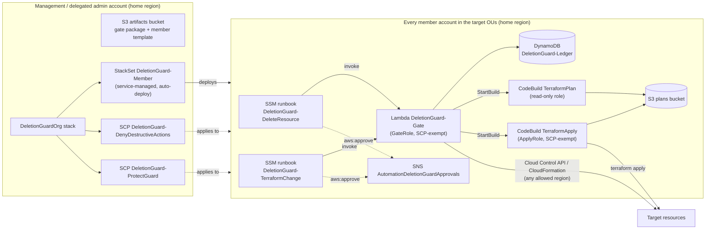
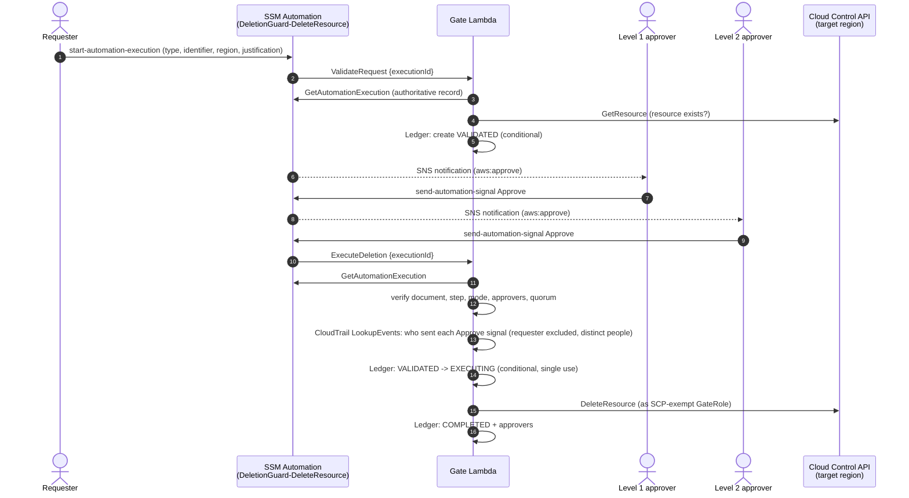
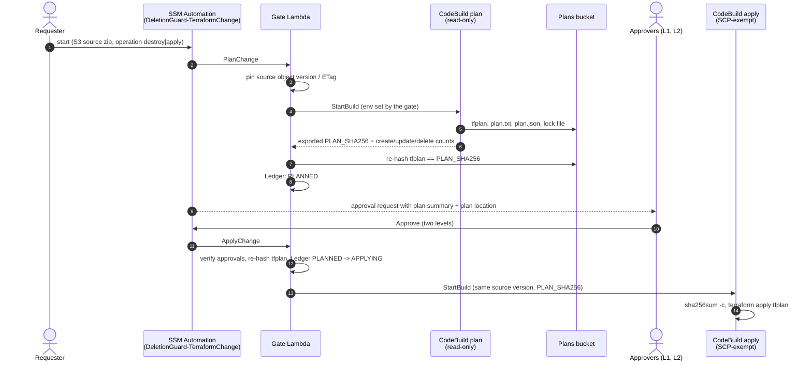

# DeletionGuard architecture

DeletionGuard enforces multi-party approval for the deletion of AWS resources in an
AWS Organization. The control lives in the permission layer, so it applies
equally to the AWS Management Console, the AWS CLI and SDKs, AWS CloudFormation, the
AWS CDK, Terraform and any other tool that calls AWS APIs.

## Design principles

1. **Take the permission away from everyone.** A Service Control Policy (SCP) denies
   destructive control-plane actions to every identity in the target OUs, including
   administrators, CI/CD roles, CloudFormation service roles and the member-account
   root user. A tool cannot bypass an explicit SCP deny.
2. **Give it back to exactly one verified path.** Only two roles are exempt from the
   deny: `DeletionGuard-GateRole` (used by the gate Lambda) and
   `DeletionGuard-TerraformApplyRole` (used by a CodeBuild project only the gate can
   start). Nobody can assume, pass, or modify these roles.
3. **Verify approvals, don't trust the workflow.** SSM Automation `aws:approve` steps
   collect the human approvals. The gate then re-reads the execution from the SSM API
   and independently checks the approvals before it acts.
4. **Approve what will actually happen.** For Terraform, approvers approve a concrete,
   saved plan file. The apply step verifies the plan's SHA-256 and applies exactly
   that plan.
5. **Protect the guard itself.** A second SCP prevents member-account administrators
   from tampering with the gate, runbooks, roles, ledger, plan artifacts, and from
   leaving the organization.

## Components



| Component | Code | Purpose |
|---|---|---|
| Protected resource catalog | [`infrastructure/cdk/lib/protected-resources.ts`](infrastructure/cdk/lib/protected-resources.ts) | Single source of truth: the SCP deny list, the runbook's allowed resource types and the gate's IAM permissions are all derived from it |
| SCP generator | [`infrastructure/cdk/lib/scp-policies.ts`](infrastructure/cdk/lib/scp-policies.ts) | Builds the two SCPs and checks their size against the 5,120-character limit |
| Org stack | [`infrastructure/cdk/lib/org-guardrails-stack.ts`](infrastructure/cdk/lib/org-guardrails-stack.ts) | StackSet plus SCP attachment. The SCPs depend on the StackSet so the gate exists before the deny takes effect |
| Member stack | [`infrastructure/cdk/lib/member-account-stack.ts`](infrastructure/cdk/lib/member-account-stack.ts) | Asset-free template deployed by StackSets: roles, gate, runbooks, CodeBuild, ledger, plans bucket, topic |
| Runbooks | [`infrastructure/cdk/lib/runbooks.ts`](infrastructure/cdk/lib/runbooks.ts) | Two SSM Automation documents with two `aws:approve` levels |
| Terraform builds | [`infrastructure/cdk/lib/terraform-buildspecs.ts`](infrastructure/cdk/lib/terraform-buildspecs.ts) | Plan (read-only) and apply (exempt) buildspecs. They run on a customer-provided ECR image (`terraform.buildImage`) and download nothing at runtime. Deployed only when the image is configured |
| Gate | [`src/deletion_gate/`](src/deletion_gate/) | Verification and execution logic (Python, no dependencies beyond boto3) |
| Approver resolver | [`src/approver_resolver/index.py`](src/approver_resolver/index.py) | Custom resource that resolves IAM Identity Center permission set roles in each account |

## Request flow: deleting a single resource



The Lambda payload contains only the execution ID. Everything else comes from the SSM
API: the resource type, identifier and region, the requester (`ExecutedBy`) and the
approval decisions. See `Gate.handle` in
[`src/deletion_gate/gate.py`](src/deletion_gate/gate.py).

## Request flow: Terraform destroy or destructive apply



Terraform itself refuses to apply a saved plan if the state changed after the plan
was created, so an approval cannot be reused against a different state.

## What the gate verifies

All checks fail closed. Implemented in
[`execution.py`](src/deletion_gate/execution.py),
[`approvals.py`](src/deletion_gate/approvals.py) and
[`gate.py`](src/deletion_gate/gate.py).

| Check | Why |
|---|---|
| Execution ID format, then `GetAutomationExecution` | Nothing in the payload is trusted |
| Document name is the DeletionGuard runbook | Blocks look-alike documents with weaker or no approval steps |
| Execution is `InProgress`, in `Auto` mode, single target | Blocks replay of old executions and step skipping in Interactive mode |
| The currently running step is the expected step | Calls made while a request is still waiting for approval are refused (and the request is not cancelled) |
| Both `aws:approve` steps are `Success` / `Approved` | |
| Every decision comes from a configured approver of that level | Defense in depth on top of the `Approvers` list |
| No rejection recorded | |
| Every decision has a matching CloudTrail `SendAutomationSignal` event (same principal, within 5 seconds) | Identifies the person behind each approval (see below) |
| Distinct people per level ≥ quorum, each person counted once across levels | No single person can satisfy two levels |
| The requester never approves | Prevents self-approval through any permission set they hold |
| Requester and approver roles can only be assumed through SAML federation (IAM users accepted, root rejected) | Their session name is set by the identity provider, not chosen by the caller or generated by a service, so it identifies a person ([`trust.py`](src/deletion_gate/trust.py)) |
| Ledger conditional transition | Each approval can be used exactly once |
| Terraform: plan SHA-256 and source version pinned | Approvers approve what is applied |

### Identifying the people who approved

`aws:approve` records each decision against the approver's IAM principal. With IAM
Identity Center that is the permission set **role**, not the role session, for example:

```json
{"Approver": "arn:aws:iam::<account>:role/aws-reserved/sso.amazonaws.com/<region>/AWSReservedSSO_DeletionApproverTeamLead_<suffix>",
 "Decision": "Approve", "ApprovalDecisionTime": "2026-11-13T21:29:42.454913102Z", "Comment": "..."}
```

From SSM alone, the gate cannot tell which person approved, so it cannot detect a
requester approving with another permission set they hold, or one person approving
both levels. The gate therefore reads the `SendAutomationSignal` events of the
execution from the CloudTrail event history of the account
([`signals.py`](src/deletion_gate/signals.py)). Each event carries the caller's
assumed-role ARN, including the session name, which IAM Identity Center sets to the
user name and users cannot change. Each SSM decision is paired with the event of the
same principal recorded within 5 seconds of the decision time. Calls that failed, for
example from someone not in the approver list, are ignored.

If an event is not visible yet (CloudTrail typically delivers events within a few
minutes), the gate waits and retries for up to 10 minutes, then rejects the request.
Account administrators cannot modify the CloudTrail event history. People are compared
by session name for assumed roles and by user name for IAM users, case-insensitively
([`identity.py`](src/deletion_gate/identity.py)).

A session name only identifies a person when the identity provider sets it. With
`sts:AssumeRole` the caller chooses it, and with a service principal (EC2, Lambda) the
service generates it, so one person could appear as two. Requester and approver roles
must therefore trust **only** a SAML provider: IAM Identity Center, or AD FS, Okta or
Entra ID federated directly with IAM through the `RoleSessionName` attribute. The
approver resolver checks the approver roles' trust policies at deployment, and the gate
checks the requester and approver roles again at runtime
([`trust.py`](src/deletion_gate/trust.py)), so a trust policy changed later is caught too.

When a check fails after the step check has passed, the gate stops the execution,
publishes a `DeletionGuard Request Rejected` event and notification, and fails the step.
Unexpected errors are handled the same way: the request is stopped and rejected
explicitly.

## Service Control Policies

### `DeletionGuard-DenyDestructiveActions`

One statement that denies every action in the catalog unless `aws:PrincipalArn` is one of:

- `arn:aws:iam::*:role/DeletionGuard-GateRole`
- `arn:aws:iam::*:role/DeletionGuard-TerraformApplyRole`
- `arn:aws:iam::*:role/stacksets-exec-*` (lets StackSets update or remove the guard)
- anything in `additionalExemptPrincipalArns`

Service-linked roles are not affected by SCPs, so service-driven lifecycle operations
keep working. Examples are Auto Scaling scale-in, EKS managed node groups and DLM.

Only control-plane actions that destroy long-lived resources are listed. Data-plane
deletes (`s3:DeleteObject`, `dynamodb:DeleteItem`, ...) are intentionally excluded:
denying them would break applications. Use S3 Versioning and Object Lock, DynamoDB
PITR and AWS Backup for data.

### `DeletionGuard-ProtectGuard`

| Statement | Protects against |
|---|---|
| `ProtectGuardRoles` | Editing trust or permission policies of `DeletionGuard-*` roles, or creating roles with those names |
| `ProtectExemptRolesFromPassAndAssume` | Passing the exempt roles to your own Lambda, EC2 or CodeBuild, or assuming them |
| `ProtectAdditionalExemptRoles` | Creating a role with the name of an additional exempt role (for example `AWSControlTowerExecution` in an account where it does not exist), or changing, passing or assuming an existing one. Exemptions are by name, so without this an administrator could mint their own exempt role |
| `ProtectGuardFunctions` | Changing gate code, configuration, aliases or permissions |
| `OnlyRunbooksInvokeGate` | Direct invocation of the gate (noise and DoS) |
| `ProtectGuardRunbooks` | Editing the runbooks (for example, weakening approvers) |
| `ProtectGuardBuildProjects` | Starting the Terraform builds with buildspec or environment overrides |
| `ProtectGuardLedger` | Rewriting the audit and single-use ledger |
| `ProtectGuardPlanArtifacts` | Replacing an approved plan file, or tampering with the plans bucket access logs |
| `ProtectGuardNotifications` | Silencing approval notifications and event forwarding |
| `ProtectGuardStack` | Updating or deleting the StackSet-managed stack locally |
| `DenyLeavingOrganization` | Removing the account from the SCPs entirely |

## Threat model summary

| Attempt | Result |
|---|---|
| Delete in the console or with the CLI/SDK, even as administrator or root user | Explicit SCP deny |
| `terraform destroy`, `cdk destroy`, `aws cloudformation delete-stack` from a pipeline | Explicit SCP deny (CloudFormation service roles are subject to SCPs) |
| Terraform `awscc` provider or Cloud Control API | `cloudformation:DeleteResource` and the underlying action are denied |
| Create a Lambda that uses `DeletionGuard-GateRole` | `iam:PassRole` denied |
| Create a role named like an exempt role (e.g. `AWSControlTowerExecution`) and assume it | `iam:CreateRole` / `iam:UpdateAssumeRolePolicy` denied |
| Edit the gate or the runbook approver list | Denied by `DeletionGuard-ProtectGuard` |
| Run a copy of the runbook with self-chosen approvers and call the gate | Gate rejects: wrong document name. Direct invocation is also denied |
| Approve your own request | Gate rejects |
| One person approves both levels | Gate rejects |
| Re-use an approved execution | Ledger conditional write fails |
| Change the Terraform code or plan after approval | Source version pinned. Plan SHA-256 mismatch is rejected |
| Start the apply CodeBuild project directly with a custom buildspec | `codebuild:StartBuild` denied |
| Leave the organization | Denied |
| Administrator of the **management account** | Out of scope: SCPs do not apply to the management account. Keep workloads out of it and control access to it separately |

## Multi-account and multi-region

- SCPs are global. The deny applies in every region of every account in the target OUs.
- `aws:approve` does not support multi-account or multi-Region automations. DeletionGuard
  therefore runs **one home region per account** and passes the target region as a runbook
  parameter. The gate creates Cloud Control and CloudFormation clients in that region.
- Requests are opened, approved and audited in the account that owns the resource.
  Optionally, all guard events (runbook status changes, gate decisions, Terraform apply
  builds) are forwarded to a central EventBridge bus (`centralEventBusArn`).
- New accounts that join a target OU get the guard automatically (StackSets
  auto-deployment).

## Design decisions and trade-offs

| Decision | Alternative considered | Reason |
|---|---|---|
| SSM Automation `aws:approve` | Systems Manager Change Manager | Change Manager is closed to new customers since November 7, 2025 |
| Identify approvers through CloudTrail | Rely on Identity Center assignment hygiene (nobody holds two of the three permission sets) | `aws:approve` records only the permission set role. CloudTrail gives a verifiable, tamper-resistant per-person record, at the cost of waiting a few minutes after the last approval |
| Gate verifies approvals | Trust the runbook flow | The runbook can be started in Interactive mode, copied, or invoked out of order. The gate is the security boundary |
| Cloud Control API for deletions | One handler per service | One code path for every resource type. The catalog limits what can be requested |
| Approve a saved Terraform plan | Approve a request description | Approvers see exactly what will be destroyed. A drift between approval and apply is impossible |
| Two SCPs | One SCP | The 5,120-character limit, and a clear separation of purposes |
| Customer-provided Terraform image in ECR | Download Terraform in the buildspec | No third-party download at runtime. The customer scans, pins and controls the toolchain the exempt apply role runs |
| Exempt roles by fixed name | Tag-based exemption | Tags can be changed by account administrators. Names are protected by the second SCP |
| No tag-based scoping of the deny | Deny only for tagged resources | Not every delete action supports `aws:ResourceTag`. A tag condition would fail open for those actions |
